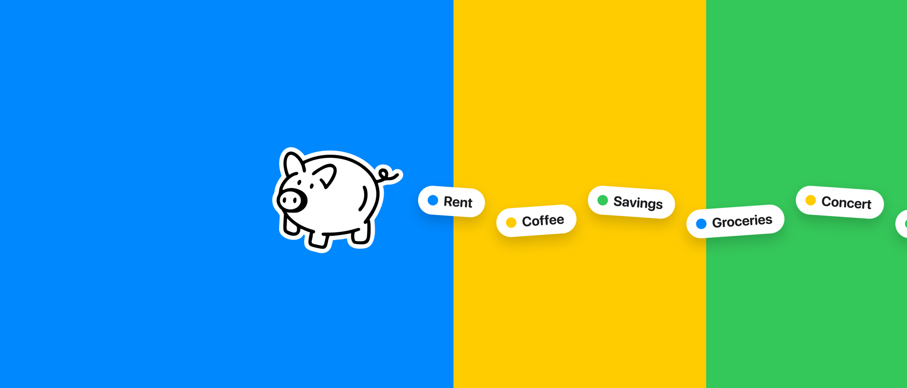
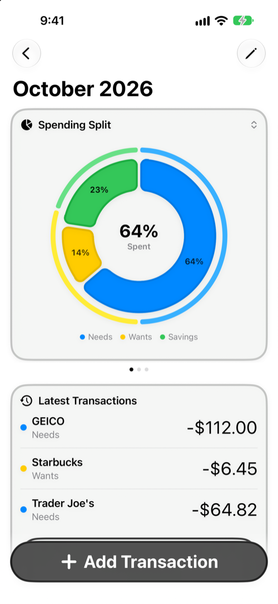
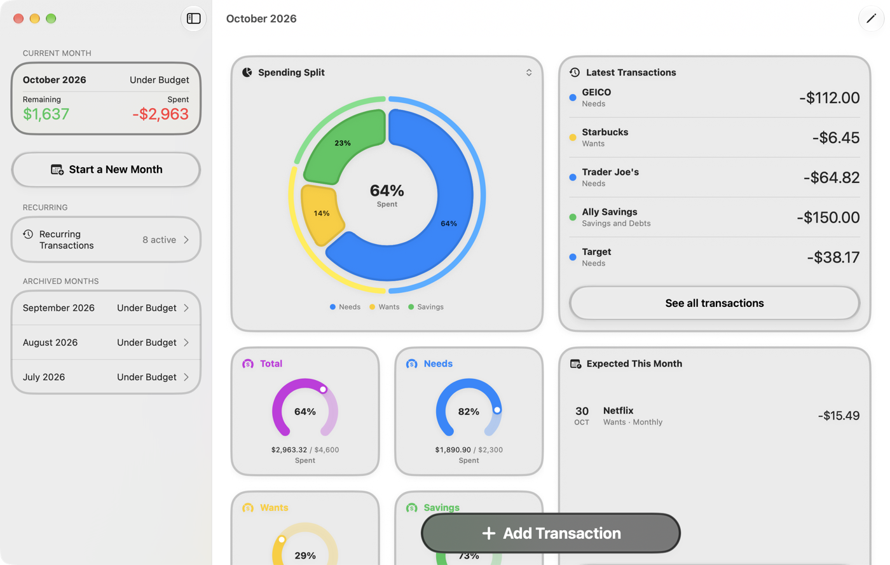

  

# Trente

The 50/30/20 budget for iPhone, iPad and Mac. No ads, no account, no bank connection.

Learn more at [trente.app](https://trente.app).

  
  &nbsp;
  

## Features

- **Three categories:** Needs, Wants, and Savings and Debts, with a split you can adjust at any time.
- **Apple Pay logging:** a Shortcuts automation fills in the expense after each purchase, and one tap saves it.
- **Recurring transactions:** see what's expected this month and confirm it, or let Trente+ record it for you.
- **Widgets:** what's left in each category on your Home Screen and Lock Screen.
- **iCloud sync:** your budget follows you across devices, with no third-party server.
- **CSV export:** take all your data with you whenever you want.
- **Languages:** English, French, Spanish, Italian, German, Korean and Portuguese.

Trente is free. The optional Trente+ subscription adds automatic recurring transactions, unlimited Apple Pay logging, notes and photos on transactions, and more app icons.

## Privacy

Trente collects no data. Your budget stays on your devices and in your iCloud account. Read the [privacy policy](https://carbo-estaque.fr/trente/privacy).

## Building

Requires Xcode 27. The app targets iOS, iPadOS and macOS 27.

1. Open `Trente.xcodeproj`.
2. Select the `Trente Dev` scheme.
3. Set your own team under Signing & Capabilities for each target you build.
4. Run.

Debug builds use an in-memory store that never syncs. To test iCloud sync, turn on the `-useICloudStore` launch argument in the scheme.

Run the tests from the `Trente` scheme.

## Project layout

| Path | Contents |
| --- | --- |
| `Trente/Model` | SwiftData models. Start with the [domain model guide](Trente/Model/README.md). |
| `Trente/Services` | Business logic |
| `Trente/Views` | SwiftUI screens and the design system |
| `TrenteWidget` | Widget extension |
| `TrenteTests` | Unit tests |
| `Scripts` | Release and App Store capture tooling |

The release process is described in [RELEASING.md](RELEASING.md).

## Credits

The pig and rocket illustrations are adapted from [Piggy Savings](https://thenounproject.com/icon/piggy-savings-5860187/) and [Financial Startup](https://thenounproject.com/icon/financial-startup-5860236/) by Vectors Market, from Noun Project, licensed under [CC BY 3.0](https://creativecommons.org/licenses/by/3.0/).

## License

The source is public to read, but Trente isn't open source for the moment. All rights are reserved.
